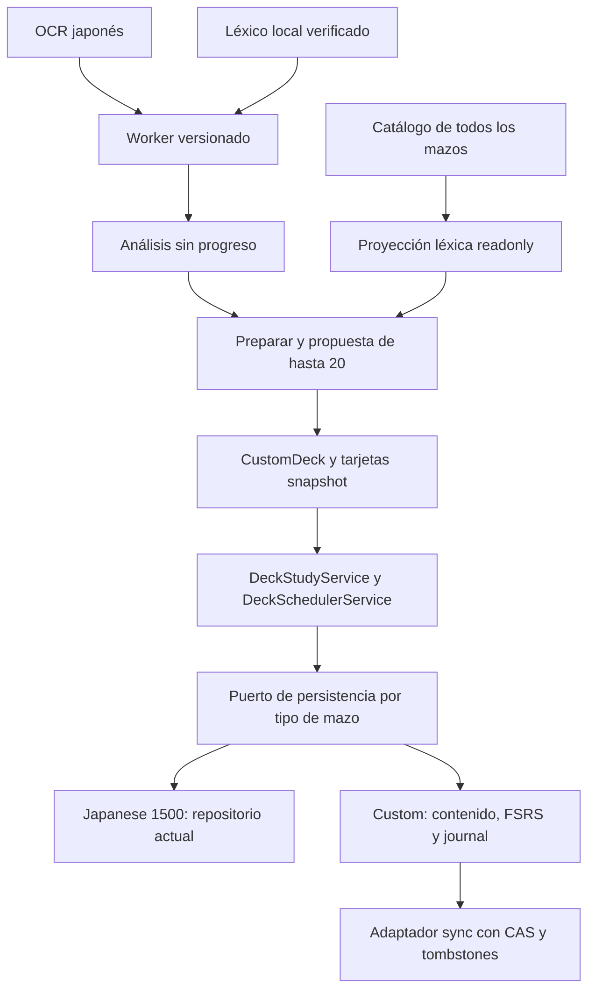

# Manga × Mazos V1 — Hito 0: auditoría y diseño técnico

Estado: **propuesta para revisión, sin implementación**. Fecha: 2026-10-21.
Base auditada: HEAD `02cdd7a` y árbol de trabajo actual. Ya existen cambios pendientes de Stats V2; se conservan íntegros. Versiones del lockfile: Angular 22.2.0 y ts-fsrs 5.4.2.

## 1. Resumen y decisiones funcionales confirmadas

El motor de Mazos es reutilizable: cola y estadísticas reciben un mazo/índice, y el progreso distingue `(deckId,entryId)`. No basta añadir una fila a `STUDY_DECKS`: faltan catálogo dinámico, contenido persistido y sincronizado, identidad léxica verificable y protocolo de edición/borrados.

**Confirmado por el prompt:** mazo independiente por volumen, creado solo mediante «Preparar mazo de esta obra»; hasta 20 propuestas fiables; Japonés → Significado; reverso con lectura, significado y contexto; Again/Good y motor de Mazos; FSRS independiente por tarjeta y mazo. Se consultan todos los mazos para clasificar conocidas/aprendiendo/pendientes/desconocidas. Conocida requiere Review y estabilidad ≥14 días; pendientes no aportan cobertura. Equivalencias no deben duplicar palabras. Selección automática excluye palabras ya estudiadas en otros mazos, pero permite adición manual. Análisis conservador, local e independiente del progreso. Borrar manga conserva mazo/tarjetas. El contenido custom debe sincronizarse para cuentas autenticadas. Manga Saved FSRS no se altera.

**Propuestas, no decisiones funcionales ya aprobadas:** contratos siguientes, granularidad léxica, motor concreto, fallback de idiomas, política de archivados/borrados, protocolo de conflicto/undo, presupuestos móviles y confirmación de preview. Se enumeran para revisión en §11.

Bloqueos: catálogo fijo; identidad de diccionario inestable entre importaciones; falta de glosas fiables en todos los idiomas; exactitud/memoria móvil no medidas; protocolo remoto custom aún inexistente.

## 2. Arquitectura actual y mapa de archivos

Los paths de las tablas parten de `src/app/`, salvo que se indique otra raíz.

### 2.1 Mazos, motor y límites

| Archivo | Hallazgo |
| --- | --- |
| `core/models/deck.model.ts` | StudyDeck: id/nameKey/cardCount/contentType/settings. Solo japanese-word. Títulos de usuario no pueden tratarse como claves i18n |
| `core/models/japanese-word-deck-entry.model.ts` | Entrada editorial amplia: id/guid/order, palabra/lectura, furigana, frases, notas, frecuencia y media. Significados ES/EN obligatorios, no CA. No rellenar campos ficticios para adaptar OCR |
| `core/models/deck-study.model.ts` | DeckCardProgress contiene deckId/entryId y snapshot FSRS. DeckReviewEvent contiene rating, antes/después, log, cardBefore y elapsedAnswerMs. DeckDailyState separa introducciones, override y completedAt |
| `data/study-decks.ts`, `data/japanese-1500*.generated.ts` | Un único catálogo builtin y findStudyDeck síncrono. Japanese 1500 tiene 1500 entradas |
| `core/services/deck-scheduler.service.ts` | Again/Good, fuzz por defecto, enable_short_term=false, pasos 1m/10m, reaprendizaje 10m, máximo 36500 días. Personaliza graduación inicial a Review con vencimiento de un día; conservar también esta política |
| `core/services/deck-study.service.ts` | Prioriza Learning/Relearning vencidos; Review vencidas por riesgo/recuperabilidad; nuevas por índice y límite. Orden mixed/before/after. Genérico en contenido, pero inyecta persistencia legacy directamente |
| `core/services/deck-database.service.ts` | IndexedDB por workspace kana-study-decks v1: card-progress `[deckId,entryId]`, review-events `id`, daily-state `[deckId,localDate]`. Commit de los tres stores atómico; outbox se escribe después en otra base. No contiene mazos ni tarjetas |
| `core/services/deck-settings.service.ts` | Mapa por deckId en kana-study.deck-settings.v1; retención, nuevas/día y orden. Permite IDs adicionales sin cambiar configuración builtin |
| `core/services/deck-study-time.ts`, `deck-study-serialization.ts` | Día Europe/Madrid y serialización FSRS que se deben reutilizar |

**Undo:** AnkiStudyPage conserva un último evento y deshabilita undo al completar el día. Undo restaura cardBefore o borra progreso de introducción inicial, elimina evento y actualiza daily en una transacción; después encola borrados/upserts. La página revierte tiempo y reabre la tarjeta. La eliminación actual no es un tombstone remoto duradero.

**Límites:** Japanese 1500 tiene 10 nuevas/día; override diario ajustable en pasos de 5. Una introducción se descuenta una vez. Preparar 20 tarjetas no implica estudiar 20 nuevas ese día. completeSession marca el día completado cuando no quedan nuevas autorizadas ni Learning/Review vencidas; añadir contenido no debe reabrir ese día silenciosamente.

### 2.2 Consumidores del catálogo fijo

| Archivo | Adaptación futura |
| --- | --- |
| `features/anki/anki.page.ts` | STUDY_DECKS fijo; índice real solo para japanese-1500 |
| `features/anki/components/deck-card/deck-card.ts` | Presentación nameKey; admitir título literal tipado |
| `features/anki-cards/anki-cards.page.ts` | Busca siempre en JAPANESE_1500_ENTRIES, ES/EN, páginas de 120; cargar proveedor por deckId |
| `features/anki-study/anki-study.page.ts` | Map de entradas, snapshot, undo y completeSession usan índice Japanese 1500; sustituir resolución, conservar flujo y clock |
| `features/anki-stats/anki-stats.page.ts` | findStudyDeck fijo; estadísticas genéricas con cardCount que deberá ser real |
| `features/anki-settings/anki-settings.page.ts` | Resolución síncrona/draft; cargar catálogo dinámico |
| `features/anki/anki.routes.ts` | Ya tiene :deckId/cards, study, stats y settings; conservar rutas |
| `core/services/deck-content-language.ts` | CA cae a ES explícitamente para Japanese 1500; no implica traducción CA disponible |
| `core/services/daily-study-planner.service.ts` | Itera STUDY_DECKS e índice fijo; escuchar revisión de catálogo/contenido además de settings/sync/workspace |
| `core/models/daily-study.model.ts`, `core/services/daily-study-planner.ts` | titleKey y actividades por deck.id; admitir etiqueta de usuario manteniendo IDs estables |
| `core/services/profile-stats.service.ts` | Solo lee STUDY_DECKS[0] para reviews/progreso/tiempo; agregar todos sin duplicar eventos |
| `features/stats/`, `core/services/attempt-*`, `STATS_V2.md` | Trabajo previo local; no duplicar reviews de mazos como intentos Kana/Vocabulary |

La aceptación requiere volver a buscar todas las referencias a STUDY_DECKS, findStudyDeck, JAPANESE_1500_INDEX y JAPANESE_1500_ENTRIES, no solo cambiar la pantalla inicial.

### 2.3 Manga y lenguaje

| Archivo | Hallazgo |
| --- | --- |
| `core/models/manga.model.ts` | MangaVolume contiene metadatos/complete y Mokuro sin páginas; MangaPage combina Blob y OCR por volumen/índice. Bloques/líneas/coordenadas, sin confianza OCR léxica |
| `core/services/manga.repository.ts` | kana-study-manga v2 por workspace: volumes/pages/reading-progress/provisioning. Delete elimina imágenes/progreso; provisioning conserva exclusión voluntaria builtin. Sin análisis léxico |
| `core/services/manga-import.service.ts`, `mokuro-parser.ts` | Import incremental y complete=false hasta terminar, limpieza de parciales, UUID nuevo por import normal. UUIDs Mokuro opcionales no son autoridad. Captura owner/cancelación |
| `core/services/manga-source.service.ts`, `local-manga-catalog.service.ts` | Fuentes importada/builtin/catalog:. Catálogo con Mokuro opcional/diálogo; page() descarga imagen, no usarla para análisis solo OCR |
| `core/services/manga-builtin.service.ts`, `features/manga/manga.page.ts` | Biblioteca/import/provisioning/delete. No ejecutar Preparar desde sus efectos |
| `features/manga/manga-reader.page.ts`, `manga-ocr*.ts` | Consulta por caret y generaciones; Reader abandona al cambiar owner. Reutilizar patrón de cancelación |
| `core/services/japanese-lookup.service.ts` | Segmenter, spans/candidatos acotados, ranking y principal/alternativas. Consulta interactiva, no segmentación completa sin solapamientos |
| `core/services/japanese-deinflection.service.ts` | Reglas de sufijos/POS: 32 puntos de código, hasta 96 candidatos y profundidad acotada. No parser ni corrector OCR |
| `core/services/dictionary.repository.ts` | Base global kana-study-dictionary, un diccionario activo, índices por dictionaryId/expression/reading; find limita 32 filas |
| `core/models/dictionary.model.ts`, `yomitan-dictionary-parser.ts`, `yomitan-dictionary-importer.ts` | Solo acepta JMdict Spanish v3. dictionaryId UUID y term.id importación+ordinal. sequence no se valida como ent_seq semántico. No conserva idioma por glosa ni restricciones completas de sentidos |
| `core/services/manga-study-integration.service.ts` | Match Vocabulary N5/Kanji y snapshot. Una forma escrita única puede aceptarse sin lectura/contexto desambiguados: no equivale a certificación para tarjetas automáticas |
| `core/services/manga-context.service.ts` | Asistencia remota opcional. No usarla ni enviar OCR para el análisis nuevo |

Proponer fuente OCR paginada: proyección de page.ocr/cursor local y documento Mokuro japonés del catálogo cargado una vez. La estructura actual pages puede clonar Blobs al recuperar registros; medir o separar OCR en migración futura. No afirmar que ya hay una API ligera de OCR ni leer imágenes innecesariamente.

### 2.4 Saved FSRS, Supabase y workspaces

MangaStudySavedRepository usa kana-study-manga-study v2 (saved-items/sync-state/sync-meta): cambio+journal atómicos, recuperación de outbox y ACK por revisión/token. MangaSavedSyncService y `supabase/migrations/202610080003_manga_saved_sync.sql` son referencia para CAS/tombstones, no un store que deba ampliarse con mazos.

MangaFsrsService, manga-fsrs-scheduler.ts, MangaFsrsSessionService y MangaReviewHistoryService usan historial propio, pesos congelados/sin fuzz y short term activado, diferente de Mazos. No copiar su estabilidad, eventos ni colas a Mazos.

SupabaseClientService carga cliente configurado; SyncService coordina outbox/diagnósticos/pull y cambios locales pendientes. `supabase/migrations/202609300001_local_first_accounts.sql` tiene deck_card_progress/deck_review_events/deck_daily_state/deck_settings y RLS por owner, pero no contenido. deck_review_events usa id global como PK. Pull actual completo paginado; no suponer sync incremental por timestamp.

SyncOutboxService.removeProcessed compara revisión y ACK debe seguir siendo individual. Mazos usa deletes físicos y merge por lastReview/unión de eventos: eso no resuelve borrados antiguos ni ramas FSRS concurrentes. commitReview puede haberse confirmado localmente antes de fallar outbox: un retry ingenuo puede emitir otro ID.

WorkspaceService conserva Guest sin prefijo y deriva bases para usuarios. WorkspaceMigrationService copia stores legacy de Mazos e importa Saved/AttemptEvent; no contenido custom. No revertir los cambios de Stats V2 que ya existen en el árbol.

## 3. Arquitectura y contratos propuestos



DeckCatalogService/DeckContentProvider propuestos unen builtins readonly y customs del owner; no mutan STUDY_DECKS. Metadatos, índice y entradas por deckId con loading/error/not-found. DisplayName discriminado entre `{kind:'i18n',key}` y `{kind:'user',text}`.

Puerto con API equivalente a getProgress/getDeckProgress/getDeckReviewEvents/getDailyState/writeDailyState/commitReview/undoReview y contexto capturado `(workspace,deckId)`. Builtin delega al DeckDatabaseService actual; custom al repositorio nuevo. Conservar decisiones de DeckStudyService y **DeckSchedulerService idéntico**: el adaptador añade persistencia/precondiciones/recibos, no intervalos.

### 3.1 Identidad léxica

```ts
type LexicalKey = string; // lex1- + SHA256(canonicalJSON(anchor)), hash completo
type WorkKey = string;    // work1- + fingerprint inicial verificado
interface LexicalAnchor {
  authority: 'jmdict' | 'kana-study-curated';
  entryId: string;              // ent_seq verificado o ID editorial estable
  canonicalReading: string;     // hiragana NFC con restricciones verificadas
  homographGroup: string;       // grupo estable, nunca índice efímero de sentido
}
interface LexicalIdentity {
  schemaVersion: 1; key: LexicalKey; anchor: LexicalAnchor;
  spellings: readonly string[]; // solo variantes documentadas del grupo/lectura
  evidenceVersion: string;
}
interface LexicalEquivalence {
  id: string; left: LexicalKey; right: LexicalKey;
  evidence: 'curated'|'verified-dictionary-link'|'user-confirmed';
  evidenceRef: string; deletedAt: string|null;
}
```

Comparar ancla completa además del hash. No usar dictionaryId/term.id, título, glosa, lectura sola ni guid de Anki como identidad global. Verificar si sequence del paquete concreto es ent_seq antes de usarlo. Falta un adaptador léxico enriquecido o tabla editorial con autoridad/restricciones; sin ancla fiable, candidato provisional/manual, no ID inventado.

NFC/espacios controlados; convertir katakana→hiragana solo en lectura. No borrar kanji/dakuten/ー ni aplicar NFKC destructivo sin mapa de offsets. 橋/箸 no se unen por はし; 生 conserva lecturas/grupos distintos. Variantes de okurigana se unen solo con prueba. Una flexión se reduce al lema con evidencia morfológica y léxica, no por sufijo aislado.

Equivalencias versionadas permiten reconocer claves históricas sin rekey de tarjetas/FSRS; revocarlas invalida proyección, conserva anclas originales y separa grupos. No transitividad de coincidencias débiles. Mapping readonly verificado de Japanese 1500 `(deckId,entryId)→LexicalKey`; lo no mapeable no da cobertura automática. Conocer una unidad léxica no demuestra conocer todas sus acepciones: granularidad de homographGroup pendiente de revisión.

### 3.2 Mazo, tarjeta y vínculo

```ts
interface CustomDeck {
  schemaVersion: 1; id: string; // md-<hash(workKey,purpose)>, sin ':'
  title: string; contentType:'japanese-word'; purpose:'manga-vocabulary-v1';
  workKey: WorkKey; sourceTitle: string; settingsDefaults: DeckSettings;
  status:'active'|'archived'; createdAt:string; updatedAt:string;
}
interface LocalVolumeDeckLink {
  workspace:string; volumeId:string; workKey:WorkKey; deckId:string;
  ocrFingerprint:string; association:'exact-fingerprint'|'user-confirmed';
}
interface CardGloss {
  text:string; language:'es'|'en'|'ca';
  source:{kind:'curated'|'dictionary'|'user';sourceId:string;revision:string};
}
interface CardContextSnapshot {
  workKey:WorkKey; sourceTitle:string; sourceOcrFingerprint:string;
  pageNumber:number; blockIndex:number; lineIndexes:readonly number[];
  fragment:string; surface:string;
  surfaceRangeUtf16:readonly [number,number]; // dentro del fragmento, comprobado
}
interface CustomDeckCard {
  schemaVersion:1; id:string; // mc-<hash(deckId,lexicalKey,direction)>
  deckId:string; lexicalIdentity:LexicalIdentity;
  direction:'japanese-to-meaning'; word:string; reading:string;
  glosses:readonly CardGloss[]; context:CardContextSnapshot;
  order:number; contentVersion:number; createdAt:string; updatedAt:string;
}
```

Unicidad de tarjeta activa por `(deckId,lexicalKey,direction)` con comparación de tupla/hash completo. En progreso, entryId=CustomDeckCard.id. Otra obra produce otra tarjeta/estado incluso para la misma LexicalKey. Los snapshots permiten estudiar sin manga/diccionario en el segundo dispositivo.

No forzar JapaneseWordDeckEntry con audio/frecuencia/frases ficticios: proponer DeckStudyEntryView mínimo (id, palabra, lectura, glosas, contexto y segmentos opcionales); el adaptador builtin conserva sus medios/datos. Renderizar texto/segmentos, nunca HTML de usuario. Edición de glosa/contexto/título o errata sin cambio léxico conserva IDs/FSRS; otra unidad léxica requiere nueva tarjeta explícita, no transferencia de estabilidad. Reanálisis no pisa ediciones manuales.

### 3.3 Análisis de obra, sin estado del usuario

```ts
interface AnalysisVersion {
  schema:1; extraction:string; normalization:string;
  tokenizer:{name:string;version:string;dictionaryDigest:string};
  lexiconDigest:string; deinflection:string;
  identityPolicy:string; classificationPolicy:string;
}
interface MangaVocabularyEntry {
  id:string; lexicalIdentity?:LexicalIdentity; surfaceForms:readonly string[];
  lemma?:string; reading?:string; glosses:readonly CardGloss[];
  partOfSpeech?:string;
  classification:'verified'|'ambiguous'|'unknown'|'excluded';
  reasons:readonly string[]; occurrences:number; distinctPages:number;
  contextSampleIds:readonly string[];
}
interface MangaVocabularyAnalysis {
  id:string; // hash(ocrFingerprint,canonicalJSON(version))
  workKey:WorkKey; ocrFingerprint:string; version:AnalysisVersion;
  status:'staging'|'ready'|'failed'|'cancelled';
  pageCount:number; completedPages:number; verifiedOccurrences:number;
  unresolvedSpans:number; excludedSpans:number;
  createdAt:string; completedAt:string|null;
}
```

Ocurrencias paginadas en otro store, con offsets originales y mapa de normalización; no todos los tokens en un array del manifiesto. Ratings/estabilidad/selección por conocimiento nunca entran en la caché. Correcciones manuales son decisiones con procedencia aparte, no resultados automáticos reetiquetados.

## 4. Persistencia y publicación del catálogo

Propuesta: base nueva `kana-study-custom-decks-v1`, claves compuestas con workspace exacto, siguiendo el patrón ya presente de AttemptEvent. Evita colisiones al sanear IDs de cuenta y no comparte el borrado de MangaRepository.

| Store propuesto | Clave e índices |
| --- | --- |
| decks | `[workspace,deckId]`; owner/status y owner/workKey/purpose |
| cards | `[workspace,deckId,cardId]`; por mazo, lexicalKey y unicidad de tupla |
| volume-links | `[workspace,volumeId]`; por workKey/deckId |
| lexical-links | `[workspace,linkId]`; equivalencias verificadas y tombstones |
| analyses | `[workspace,analysisId]`; por workKey/status |
| analysis-entries | `[workspace,analysisId,entryId]`; por clasificación |
| analysis-occurrences | `[workspace,analysisId,pageIndex,spanOrdinal]`; cursores por página |
| fsrs-progress | `[workspace,deckId,entryId]`; por mazo/due/state; mismo DeckCardProgress |
| fsrs-events | `[workspace,eventId]`; por mazo/entryId/reviewedAt; payload DeckReviewEvent |
| daily-state | `[workspace,deckId,localDate]` |
| sync-state/mutations/conflicts/meta | `[workspace,...]`; revisiones, recibos y recuperación |

Una tarjeta nueva puede no tener fila de progreso. cardCount deriva de contenido activo, no de snapshots FSRS.

**Preparación propuesta:** el botón inicia análisis y preview; confirmar la propuesta publica mazo/tarjetas/vínculos/journal en una sola transacción. Esa confirmación adicional es propuesta UX a revisar. No crear por importación, abrir biblioteca, acabar análisis o consultar cobertura. Si ya existe mazo activo de esa WorkKey, abrir/proponer adiciones. Si hay tombstone, ofrecer restauración explícita con revisión actual. IDs/constraints deterministas impiden duplicados entre dispositivos; un lock de UI no basta.

Análisis por páginas/lotes, con staging/checkpoint/checksum; ready solo tras completar. Cancelación no publica resultado parcial. Mantener último ready compatible y limpiar solo temporales sin job activo. Comprobar quota, onblocked, versionchange y cierre de conexiones. Nunca mantener transacción IDB abierta durante tokenización/fetch/red.

Mutación custom de contenido/FSRS y journal son atómicos en esta base. Outbox general es transporte recuperable. Si falla después, recuperar intención y recibo sin repetir estudio. Retry conserva operationId/eventId/fecha/snapshot/owner; no repetir DeckStudyService.rate con otro ID tras commit local. Distinguir error de guardado de error de transmisión. No inflar reps ni tiempo por repetir publicación.

DeckCatalogService expone revisión y estado por owner. Altas, ediciones, archivados y pull invalidan índices/conteos. Daily Study escucha esas revisiones y consulta índices de todos los mazos con concurrencia limitada, manteniendo owner/generation. Perfil debe agregar reviews únicos, sin sumar la misma evidencia al bloque Manga y Mazos.

## 5. Sincronización, unión, borrados y cuentas

### 5.1 Contrato remoto propuesto, sin SQL en este hito

Tablas nuevas propuestas: custom_decks, custom_deck_cards, custom_deck_progress, custom_deck_review_events, custom_deck_daily_state, custom_deck_lexical_links y recibos de operaciones. PK/índices incluyen user_id, especialmente eventos: no repetir el PK global legacy al importar Guest a cuentas distintas. Solo sincronizar contenido del mazo, contexto breve, procedencia y estudio; no imágenes, OCR completo ni caché de análisis.

```ts
interface SyncedEntity<T> {
  id:string; payload:T|null;
  serverRevision:string; // decimal entero; no reloj del cliente
  deletedAt:string|null; lastOperationId:string;
}
interface CustomMutation<T> {
  operationId:string; entityId:string; baseRevision:string;
  kind:'create'|'edit'|'delete'|'restore'|'review'|'undo'|'import';
  payload:T|null;
}
```

Propiedad derivada de auth.uid(), no del payload. RLS owner y validación compartida de tamaños/esquema; RPC transaccionales que revalidan autorización. No convertir preferencias en un gran JSON de mazos ni modificar parcialmente el protocolo builtin.

CustomDeckSyncAdapter participa en prepare/push/pull: recupera journal, confirma contenido con recibos y luego expone progreso compatible. Manifiesto de revisión/cantidad/ready y reconciliación paginada impiden presentar catálogo incompleto como mazo vacío. Progreso huérfano se conserva en cuarentena hasta recibir contenido, no se borra ni se estudia vacío.

Tipos nuevos de outbox/diagnóstico solo en Hito 4. ACK individual por operación/revisión; removeProcessed solo sobre versión confirmada. Cambios nuevos durante push/pull quedan pendientes para otro ciclo. Refrescos de catálogo/workspace no reinician confirmaciones del ciclo actual. No reconstruir operaciones desde snapshots confirmados de caché.

### 5.2 Unión y conflictos

- Entidades distintas se unen. Misma intención conserva ID/recibo. Dos altas de misma tupla confluyen; diferencias de contenido causan conflicto CAS, no dos tarjetas ni sobrescritura silenciosa.
- Adiciones diferentes a un mazo se unen; título/contexto se editan por revisión, no por reloj de dispositivo.
- Delete crea tombstone. Gana frente a create/import/bootstrap obsoleto; restore exige revisión actual y acción explícita. Restaurar un mazo no restaura tarjetas borradas individualmente.
- No eliminar tombstones por antigüedad arbitraria: hace falta política de retención/ACK de dispositivos antiguos.
- updatedAt de una glosa no decide qué snapshot FSRS gana.

**Dos repasos de la MISMA tarjeta:** lastReview no une dos ramas nacidas del mismo cardBefore. No promediar due/S ni reproducir eventos como si el fuzz no existiera. Propuesta: RPC review con baseRevision/baseStateHash, respuesta inmutable y recibo. Si la base cambió, conservar rama local en conflicts con respuesta/fecha originales y exigir resolución. Proyección canónica solo con commits aceptados; observaciones conflictivas aparte, visibles y sin inflar retención/reps/tiempo canónicos. Mantener rama confirmada y volver a evaluar realmente es una posible resolución; no fabricar repaso retroactivo automático. **La política necesita revisión antes de Hito 4.** Tarjetas distintas conservan revisiones/colas independientes.

**Undo custom:** anulación por eventId/revisión con recibo; restaurar cardBefore/daily solo si sigue siendo la cabeza válida. Undo antiguo no borra repaso posterior de otro dispositivo. Vista efectiva excluye anulados pero conserva auditoría/tombstone. Mantener un nivel de undo, restricciones del día completo y reversión de introducción/tiempo. No aplicar silenciosamente este protocolo nuevo al historial builtin.

### 5.3 Workspace y Guest

Jobs capturan owner al empezar y verifican antes de publicar/actualizar UI. Cambio de owner cancela job y descarta callbacks visibles; no mueve automáticamente trabajo a otra cuenta. El diccionario global es recurso instalado, no evidencia de conocimiento de otra cuenta. Análisis/asociaciones/conocimiento se particionan; cualquier reutilización futura de caché compartida requiere no filtrar selección/contenido privado.

Importación Guest explícita por páginas/checkpoint: catálogo, tarjetas, anclas, FSRS, eventos, daily y journals. No borra origen ni hace put sobre progreso ya estudiado en destino. Reintento conserva IDs y recibo dentro de cuenta; conflictos de progreso requieren política propia. PK remoto `[user_id,eventId]` permite mismo evento Guest en cuentas distintas sin colisión de owner. «Solo cuenta» no importa nada.

Incorporar custom IndexedDB a hasGuestData. Si falta contenido o falla copia, no marcar importación completa ni exponer reviews listos. Bibliotecas/imágenes no se importan automáticamente con los mazos; estudiar solo necesita snapshots.

## 6. Análisis lingüístico y herramienta

### 6.1 Comparación con fuentes primarias

Consulta: 2026-10-21. No se instaló/ejecutó tokenizer ni se midieron precisión/RAM/tiempos. No se procesó ni envió OCR del usuario en este hito. Valoraciones de integración/rendimiento son hipótesis por validar.

| Alternativa | Exactitud/evidencia | Licencia/tamaño | Angular y móviles; propuesta |
| --- | --- | --- | --- |
| Intl.Segmenter | Límites de palabra; no garantiza lema/lectura/POS. Dependiente de datos del navegador | Sin paquete/diccionario añadido por la app | Ya existe fallback. Útil para candidatos, insuficiente como certificación automática. [ECMA-402](https://tc39.es/ecma402/#segmenter-objects) |
| TinySegmenter | Segmentación compacta, sin lexicón de lecturas/flexiones/sentidos | Pequeño, tamaño exacto depende de artefacto; ports con licencias diferentes, verificar el elegido | Fallback de spans, no autoridad léxica. El port enlazado declara MIT. [Port y documentación](https://github.com/code4fukui/TinySegmenter) |
| Kuromoji.js + IPADIC | Tokenización, base/POS/lectura; desconocidos/OCR requieren validación externa | Motor Apache-2.0; avisos IPADIC NAIST/ICOT. Suma de 12 dict/*.gz consultados: **17.791.956 bytes (~16,97 MiB)**, sin motor ni RAM descomprimida | Distribución browser existente, empaquetado antiguo: probar Worker/Angular/CSP/base-href. **Candidato inicial propuesto**, condicionado a spike y léxico. [Repo](https://github.com/takuyaa/kuromoji.js), [assets: tamaños de fichero sumados](https://github.com/takuyaa/kuromoji.js/tree/master/dict), [avisos](https://github.com/takuyaa/kuromoji.js/blob/master/NOTICE.md) |
| Sudachi/WASM | Granularidad y normalización; no garantía de resolver nombres/OCR | SudachiDict Apache-2.0 con recursos/avisos propios. La distribución enlazada advierte **>50 MB gzip**; no generalizar a toda build/edición | Browser posible; no escoger ese bundle integrado por defecto en móvil. [Diccionario](https://github.com/WorksApplications/SudachiDict), [build WASM](https://github.com/hata6502/sudachi-wasm) |
| Lindera/WASM + diccionario | Morfología dependiente del diccionario/filtros; no equiparar a Sudachi completo | Binding WASM MIT, datos con licencia propia. Artefacto/diccionario/RAM elegidos sin medir; tamaño de fuente de crate no es descarga | Alternativa del spike: init web async, diccionario separado y Worker; OPFS opcional con fallback. Probar Angular/Pages/Safari. [Instalación](https://lindera.github.io/lindera/lindera-wasm/installation.html), [browser](https://lindera.github.io/lindera/lindera-wasm/browser_usage.html), [licencia](https://github.com/lindera/lindera/blob/main/lindera-wasm/LICENSE) |

**Recomendación provisional:** JapaneseMorphologyPort con piloto Kuromoji/IPADIC en Worker y comparación Lindera. Fijar versión/commit/digest/licencias antes de adoptar. Self-host y carga bajo demanda al pulsar Preparar, no diccionario en bundle inicial ni CDN ajeno en cada análisis. Si no alcanza criterios, no activar selección automática ni bajar cautela para llegar a 20.

IPADIC no aporta traducciones ni ancla JMdict verificada. Hace falta adaptador de lectura enriquecido que preserve autoridad/restricciones/idioma, sin sustituir silenciosamente el diccionario instalado. Revisar permisos/avisos del paquete concreto: la licencia del componente japonés/inglés no prueba la de toda traducción; [EDRDG](https://www.edrdg.org/edrdg/licence.html) indica titulares separados para otros idiomas. No afirmar que todo paquete llamado JMdict tiene los mismos derechos.

### 6.2 Pipeline conservador

1. Solo OCR japonés de volumen completo. Catálogo sin Mokuro japonés: «OCR no disponible», no tokenizar traducción española ni fabricar OCR.
2. Fingerprint determinista de texto/orden de páginas/bloques/líneas y metadatos para reproducir offsets. Original y normalización separados.
3. Política explícita de unión de líneas; nunca unir bocadillos/columnas/páginas arbitrariamente. Reconstrucción incierta queda ambigua.
4. Worker por lotes con modelo reutilizado: surface/rangos/lema/POS/lectura/desconocido. Score del motor no es probabilidad calibrada.
5. Validación con formas/lecturas/POS/restricciones y desconjugación compatible. Segmentación canónica sin solapamiento: no contar simultáneamente compuesto y subpalabras alternativas.
6. verified solo con forma/lectura/entrada compatibles, sin alternativa material sin resolver, glosa con idioma/procedencia y contexto localizable. No basta principal=terms[0], frecuencia ni un kanji coincidente.
7. Nombres, onomatopeyas/interjecciones, contadores, sufijos, truncamientos y coloquialismos tienen política explícita. No excluir todo katakana ni todo kana de un carácter. Desconocido del motor/OCR dudoso → revisión, no corrección automática.
8. Guardar motivos/candidatos. Revisión manual elige/corrige palabra/lectura/glosa/ancla y mantiene procedencia user-confirmed; no inventa confianza OCR.

Fixtures necesarios: 食べなかった, 負けぬ, 来ました; 橋/箸; 生 con lecturas distintas; ここ/此処 con alias documentado; compuestos y そういう; furigana/ruby duplicado, katakana/ー, nombres iguales a palabras comunes; OCR 百合姫谷も sin segmentación certificada; Unicode suplementario y offsets UTF-16; líneas/bloques verticales. Ninguna herramienta se declara correcta para todos estos casos sin prueba.

### 6.3 Selección inicial

Filtrar verified con palabra/lectura/glosa/contexto completos y ancla equivalente válida. Consultar todos los mazos del owner y excluir automáticamente unidades con historial efectivo en otros mazos, incluso Learning/Relearning o Review inmaduro. Permitir manualmente. Una tarjeta pendiente en otro mazo no es «ya estudiada»: puede proponerse con aviso, no introducir una exclusión funcional adicional.

Deduplicar dentro del destino. Orden propuesto: frecuencia descendente, páginas distintas descendentes, primera aparición y clave estable. Fiabilidad es filtro, no peso compensable. Frecuencia de obra no equivale a frecuencia del idioma. Si hay 6 fiables, proponer 6; si no hay ninguna, no completar con suposiciones. Recalcular ranking según conocimiento sin cambiar análisis.

### 6.4 Idiomas y rendimiento

Glosa en idioma activo si existe; propuesta de fallback a idioma real disponible, claramente etiquetado en preview. ES prioritario por recurso actual; EN/CA no se inventan. Japanese 1500 mantiene CA→ES. Si se exige glosa nativa de todo en ES/EN/CA, es bloqueo de datos. Meaning sin idioma de Saved no certifica traducción del idioma UI.

Chunk Worker/lexicón separados y lazy, cache por digest y rutas relativas probadas con `/kana-study/`. No SharedArrayBuffer/COOP/COEP obligatorio. Un análisis activo por owner, cancelar/checkpoint por página, LRU de consultas y cursores. No lookupAt en cada carácter ni cálculo de volumen dentro de render.

**Presupuestos propuestos, aún no medidos:** cero bytes tokenizer en carga inicial; Worker/motor comprimido ≤1 MiB, diccionario inicial ≤25 MiB, memoria pico job ≤150 MiB en dispositivo de referencia por acordar; 100 páginas ≤30 s, cancelación ≤1 s y sin tareas UI del job >50 ms. Medir también 500 páginas, quota y reanudación. Revisar presupuesto/tecnología si falla; funcionar en desktop no certifica móvil.

## 7. Conocimiento, cobertura y proyecciones

LexicalKnowledgeProjection propuesta: `(workspace,catalogRevision,progressRevision,equivalenceVersion)`, readonly. Cards(l) son tarjetas equivalentes con ancla válida; H(l) indica algún repaso efectivo no anulado o snapshot validado con reps/lastReview coherentes si aún no llegó su evento.

Precedencia:

1. **Conocida:** existe tarjeta con State.Review (2), estabilidad finita ≥14 días e historia coherente.
2. **Aprendiendo:** H(l) sin conocida. Incluye Learning, Relearning y Review con S<14.
3. **Pendiente:** existe tarjeta sin historial efectivo. Puede no tener fila de progreso.
4. **Desconocida:** sin tarjeta ni historial vinculable.

Mature+New en mazos distintos no se promedian: basta la madura para conocida, pero ambas conservan programación independiente. Review vencida con S≥14 sigue cumpliendo el criterio aprobado; no añadir umbral de recuperabilidad. No confundir estado Review con estudiada alguna vez.

**Propuesta para revisar:** archivados participan en conocimiento, no cola diaria. Tombstoned no aportan Review actual; historial válido retenido con ancla puede justificar aprendiendo/exclusión automática, nunca estabilidad inventada. Si borrar debe borrar también conocimiento, definir esa operación explícita. Undo de única introducción vuelve a pendiente si no hay otra evidencia; anulado no cuenta.

Sea R el conjunto de unidades resueltas del análisis, deduplicado por equivalencias verificadas; f(l) sus apariciones no solapadas; K conocidas, A aprendiendo y P pendientes:

- Cobertura de tipos **resueltos**: `|R ∩ K| / |R|`.
- Cobertura por apariciones **resueltas**: `Σ(l∈R∩K) f(l) / Σ(l∈R) f(l)`.
- A y P separadas; **P nunca incrementa numerador**, A tampoco es conocida.
- Denominador cero: «sin datos», no 0 %.
- Mostrar tipos/apariciones resueltas y spans ambiguos/desconocidos/excluidos, además de mappings de mazos aún no verificables.

No llamar a esos porcentajes «comprensión del manga» ni cobertura exacta de todas sus palabras. Un span sin resolver puede contener varias: no sumarlo como un tipo desconocido con denominador ficticio. Si se muestra tasa de resolución por caracteres/spans OCR, darle nombre y denominador propios; no mezclarla con cobertura léxica.

Para selección S, proyección hipotética: sustituir K por `K ∪ S`, **suponiendo** que todas alcanzaran Review/S≥14. Crear pendientes no cambia cobertura real. No predice días/sesiones ni inventa transiciones. Conocidas no aportan incremento y equivalencias también se deduplican en S.

Si faltan mazos/progreso/mappings, marcar conocimiento incompleto, no asumir todo desconocido para autoseleccionar. Datos parciales etiquetados; bloquear selección automática hasta completar evidencia, manteniendo revisión manual.

## 8. Borrado, reimportación, invalidación y compatibilidad

- volumeId local cambia al reimportar; no identidad global. Propuesta WorkKey inicial desde fingerprint OCR completo/no vacío. UUIDs Mokuro son pistas; no unir por título/páginas similares.
- Un fingerprint es evidencia de contenido OCR, no prueba de identidad editorial: dos ediciones pueden compartir texto y el OCR puede omitir páginas. Comparar también metadatos disponibles; contradicciones o colisiones de obra requieren confirmación y un discriminador inmutable distinto. No prometer deduplicación universal a partir de texto solo. Reimport idéntica sin evidencia contradictoria recupera vínculo por fingerprint. Si cambia OCR/edición, proponer vincular al mazo existente o tratar como volumen distinto; no unir automáticamente. Nuevo fingerprint asociado al WorkKey requiere evidencia/confirmación y no rekey de tarjetas.
- Borrar manga conserva mazo/tarjetas/FSRS/contexto. No cascada ni FK desde volumen. Enlace al Reader deshabilitado sin fuente local; reverso utilizable offline/otro dispositivo.
- Borrar análisis elimina caché, no contenido/reviews. Borrar mazo/tarjeta es otra intención con tombstone; reanálisis no restaura borrados.
- AnalysisVersion incluye extracción/normalización/motor/diccionario/léxico/desconjugación/identidad/política. Cambio crea otro análisis; UI/progreso/S no lo invalida. OCR corregido no sobrescribe mazos ni contexto editado.
- Segundo navegador estudia snapshots sin descargar manga/diccionario; no subir o importar imágenes automáticamente.
- Japanese 1500 conserva id, entryIds/guid, orden, medios, settings, programación e historial. Adaptador devuelve mismos datos; no regenerar archivos para equivalencias.
- No convertir MangaStudySavedItem a CustomDeckCard ni reproducir su historial en Mazos. Guardar en Manga y añadir al mazo son acciones diferentes.

## 9. Invariantes FSRS y riesgos

Motor/parámetros/política actuales de Mazos intactos; Again=Rating.Again y Good=Rating.Good; preview coherente con cardBefore. Ningún análisis/cobertura crea review ni intervalos nuevos. Edición de contenido no reinicia memoria. No copiar S de Japanese 1500 ni Saved a tarjeta custom. Estado global conocido es solo proyección; due/reps/S se conservan por mazo/tarjeta/workspace.

| Riesgo | Medida y prueba |
| --- | --- |
| Doble clic/dispositivos/reanálisis duplican mazo | ID y constraint por WorkKey/purpose, recibos; confirmar obras ambiguas |
| Colisión/homófonos/escapes | Hash completo + ancla; nunca reading/glosa sola ni IDs truncados; fixtures Unicode/bytes |
| Equivalencia falsa aumenta cobertura | Prueba verificable, revocación versionada y recomputación sin rekey de FSRS |
| OCR sucio, nombres comunes | Umbral por evidencia, ambigüedad visible y corpus anotado; no completar 20 a fuerza |
| Idiomas/licencias | Procedencia por glosa, fallback visible y revisión de paquete/avisos |
| IDB confirmado y outbox fallida | Journal atómico/recibo/retry estable; no duplicar reps/tiempo |
| Descarga parcial/órdenes invertidos | Manifiesto ready/cantidad/revisión, cuarentena y retry; no catálogo falsamente vacío |
| Dispositivo viejo resucita borrado | Tombstone duradero y restore CAS; no ausencia como borrado |
| Review/undo simultáneo | CAS por base, ramas conservadas y resolución explícita; no LWW como merge FSRS |
| Cambio de owner durante await | Owner capturado, abort/generation y guardas de publicación/commit |
| Borrar manga pierde tarjetas | Snapshot y vínculo débil; test de estudio sin fuente en otro browser |
| Daily Study/perfil omiten customs | Catálogo reactivo, índices completos y agregación de eventos únicos |
| Bundle/RAM móvil | Worker lazy, assets/digests, lotes/checkpoints/cancelación y medición física |
| Snapshots corruptos | Validación/cuarentena; no conocimiento con NaN/S inexistente ni borrado masivo |
| Contexto malicioso/payload grande | Texto plano, límites cliente/SQL por bytes, RLS owner y arrays acotados |

Límites iniciales propuestos a revisar: palabra/lectura ≤256 unidades UTF-16; glosa ≤2000 por idioma, fragmento ≤1200, título ≤160, ≤3 glosas localizadas principales y payload tarjeta ≤32 KiB. Medir JSON UTF-8 y condición equivalente de jsonb remoto, no longitud JS como bytes SQL. Rechazar U+0000 y surrogates inválidos; probar expansión de escapes/multibyte. Fuera de límites pasa a revisión/no elegible, sin truncar identidad ni fabricar reverso.

## 10. Hitos 1–5: implementación futura, tests y aceptación

Ninguna de estas funcionalidades está implementada por este documento. No publicar V1 como completa con una demo que solo sincronice progreso.

### Hito 1 — Contratos, catálogo y puerto

Contratos/validadores versionados, DisplayName, proveedores y adaptador builtin; repo custom/journal con contexto owner. Integrar consumidores de catálogo incrementalmente, sin análisis ni modificar Japanese 1500.

Tests: mismos 1500 IDs/índices/datos/settings, rutas/deep links; mismos snapshots/ratings/undo/tiempos tras adaptar; nueva base, upgrade bloqueado/versionchange, rollback, workspaces y recuperación journal.

Aceptación: fixture custom se resuelve a sus entradas reales sin usar índice Japanese 1500. Builtin no cambia/duplica. Fallos de almacenamiento no publican mazo parcial.

### Hito 2 — Spike lingüístico y análisis

Comparar Kuromoji/Lindera con corpus anotado, fijar versión/licencias; fuente solo OCR, Worker, caché/checkpoint y adaptador léxico de autoridad/restricciones/idiomas.

Tests: fixtures §6, offsets/solapamientos, cancellation/reload/quota, invalidación por modelo/diccionario; progreso no invalida. Nada de envío de texto, imágenes ni MangaContextService.

Aceptación propuesta: ≥200 casos anotados, ≥50 de ambigüedad/OCR/nombres; precisión autoelegible ≥98 % con muestra/intervalos informados, sin usar recall para forzar 20; cero autoaceptaciones en fixtures marcados sin evidencia. Es una meta, no resultado medido. Presupuestos §6.4 y Safari/Chrome físicos; si falta dispositivo, gate no validado.

### Hito 3 — Conocimiento, cobertura y preparación

Puente Japanese 1500 y equivalencias, agregación todos los mazos, clasificación readonly y preview explícita hasta 20.

Tests: S=13.999/14; New/Learning/Review/Relearning; Mature+New en distintos mazos; undo única introducción; pendientes sin cobertura; homófonos/alias revocado; glosas ausentes, catálogo incompleto, tipos/apariciones/proyección deduplicados y manuales. Doble clic/reimport idéntica.

Aceptación: sin Preparar/confirmar no hay nuevo mazo. Solo verificados auto-propuestos; con historial en otros mazos se excluyen. Manual no hereda FSRS. Análisis idéntico al cambiar progreso.

### Hito 4 — Sync custom, Guest y tombstones

Migraciones aditivas/RPC nuevas y RLS/validación, adaptador al coordinador, recibos/CAS, recuperación y conflictos review/undo. Importación Guest íntegra/reintentable.

Tests con dos cachés y SQL real local: ACK perdido/retry, escritura durante pull, contenido/progreso fuera de orden, delete offline contra edit/import antiguo, restore explícito, altas idénticas, review simultáneo/undo obsoleto, permisos cruzados, Guest→A/Guest→B sin colisiones. Copia parcial conserva origen/progreso destino.

Aceptación: la misma cuenta autenticada en otro navegador recibe contenido/contexto y estudia sin manga/diccionario. Conflicto real queda pendiente/error visible, no falso Synced. ACK no se reencola y borrados no resucitan. Regresiones legacy Japanese 1500/Manga intactas.

### Hito 5 — UX integrada y QA

Biblioteca/detalle/preparación/revisión, mazos, vínculos Reader, Daily Study/perfil y estados OCR/recursos faltantes; teclado e idiomas.

Playwright: import sin creación implícita, preparar ≤20, anverso/reverso correctos, Again/Good/undo, editar glosa conservando due/S/reps; misma palabra en dos mazos independientes; borrar manga conserva mazo, estudio en segundo browser; offline/reload/cuentas/Guest/delete/restore.

Responsive 320/390/tablet/desktop, ES/EN/CA, cinco temas, lector de pantalla, texto seguro y `/kana-study/`; Safari iOS/Chrome Android físicos y corpus grande.

Aceptación: npm test, tsc app/spec, build production, Playwright afectado, SQL y git diff --check; matriz de FSRS builtin/Saved, Daily Study y sync sin regresión. No ampliar Stats V2 ni algoritmo pedagógico como efecto lateral.

## 11. Decisiones que requieren revisión antes de programar

| ID | Propuesta o decisión pendiente | Gate |
| --- | --- | --- |
| D1 | Puerto/repo custom separado reutilizando motor, frente a ampliar DB/protocolo legacy; confirmar coste de la separación | H1 |
| D2 | Fuente de ent_seq verificado, granularidad de homógrafos, mapping Japanese 1500 y revocación de equivalencias | H1–3 |
| D3 | Spike Kuromoji/IPADIC vs Lindera, versión/avisos/hosting y presupuestos móviles sin medir | H2 |
| D4 | Fallback etiquetado o glosas nativas ES/EN/CA; fuente y permisos concretos | H2–3 |
| D5 | WorkKey/reimport con OCR cambiado y confirmación adicional de preview tras Preparar | H3 |
| D6 | Cobertura solo de unidades verificadas; participación de archivados/historial tras delete | H3 |
| D7 | CAS/ramas de review/undo concurrentes y resolución visible, sin replay ficticio FSRS | H4 |
| D8 | Tablas/RPC owner nuevas, publicación consistente y retención de tombstones; no activar V1 con sync solo de progreso | H4 |
| D9 | Añadir tarjetas a día completado y Daily Study: propuesta conservar bloqueo/defaults, no reapertura automática | H3–5 |
| D10 | Límites por bytes, información visible del sync de fragmentos y conservación tras borrar obra | H4–5 |

Recomendación: revisar estas decisiones y tratar el spike lingüístico como gate. Es viable reutilizar motor, pero léxico, entrega móvil y protocolo de contenido/conflictos no están certificados por la documentación. No hace falta modificar producción para completar Hito 0.

## Validación y alcance de este hito

Se inspeccionaron modelos, servicios, páginas, migraciones y tests existentes y fuentes primarias enlazadas. No se instaló tokenizer, no se analizaron mangas del usuario ni se ejerció una cuenta remota. Tests/metas de los hitos son futuros, no resultados ejecutados. Los cambios previos de Stats V2 se preservan. Únicamente se añade este documento al scope del hito. Sin commit ni push.

Comprobaciones de Hito 0: las once secciones requeridas y bloques de código se verificaron; `npm run build` terminó correctamente con los cuatro warnings SCSS de Grammar ya conocidos; `git diff --check` correcto. El estado final añade únicamente este documento sobre el conjunto de cambios previo de Stats V2. No se ejecutaron pruebas funcionales de Manga × Mazos porque todavía no se implementa; los tests y benchmarks descritos son criterios de hitos futuros.


## 12. Hito 1 implementado — 2026-10-21

Las decisiones técnicas del Hito 1 fueron aprobadas por el prompt posterior a esta propuesta. El estado de propuesta de las secciones anteriores describe Hito 0; la implementación local actual se detalla en `MANGA_DECKS_H1.md`.

- `DeckCatalogService` resuelve metadata builtin y custom, índice y contenido propios. `DeckDisplayName` separa títulos literales de claves i18n. El proveedor builtin devuelve los objetos e índice editoriales originales, sin regeneración. Las vistas de tarjetas custom no contienen campos editoriales ficticios.
- `CustomDeckRepository` usa una base nueva y claves compuestas con workspace literal. Contenido, progreso, eventos, estado diario y journal se guardan atómicamente. Hay recibos por operación, control de versión de contenido y comparación del snapshot previo al calificar; undo conserva el evento anulado y verifica la cabeza vigente.
- La identidad léxica usa SHA-256 completo de un ancla con autoridad, entrada, lectura canónica y grupo homógrafo. No se certifica un UUID de importación como JMdict. Cambiar de ancla requiere otra identidad de tarjeta; editar una glosa/contexto conserva FSRS.
- El puerto de persistencia del `DeckStudyService` captura workspace. `DeckSchedulerService`, datos Japanese 1500 y base legacy permanecen intactos. No se crean snapshots FSRS al listar o previsualizar.
- Mazos, tarjetas, estudio, estadísticas, configuración, Daily Study y Perfil consultan el catálogo. Los valores literales se renderizan como texto; fallback de glosa etiqueta su idioma real. Japanese 1500 mantiene su presentación y CA→ES.
- El gate DI `CUSTOM_DECKS_ENABLED` permanece en false. Solo fixtures de test lo habilitan; no existe botón público, parámetro URL ni flag persistido para crear/activar mazos custom. No se envía este contenido/progreso al protocolo cloud legacy.
- El journal es durable y local, sin ACK remoto. La recuperación repite la misma operación; una transacción abortada no publica registros parciales. Hito 4 debe implementar transporte, recibos remotos, conflictos, tombstones e importación Guest antes de habilitar usuarios.
- Se reutilizan traducciones existentes ES/EN/CA. No se ha cambiado Stats V2. Resultados reales, limitaciones y archivos en el informe H1; no se considera completado el gate de validación mientras existan fallos de la suite.

## 13. Cierre validado Hito 1.1 — 2026-10-21

El gate pendiente de la sección anterior quedó resuelto en H1.1, documentado en
`MANGA_DECKS_H1.md`: cuatro procesos independientes pasaron 1735/1735 tests, incluyendo
una ejecución sin caché y órdenes distintos. Se hicieron deterministas las fechas de
Stats V2 y las aserciones de eventos con timestamps iguales; no se alteraron cálculos
de producción para acomodar pruebas. También pasaron integración Manga × Mazos,
Playwright afectado, TypeScript app/spec y build. Es evidencia de esas ejecuciones,
no una promesa de estabilidad absoluta. Los cambios de H1, H1.1 y Stats V2 se preservan.

## 14. Hito 2A experimental — 2026-10-21

Informe y decisión: `MANGA_DECKS_H2A.md`. El spike aislado en
`experiments/manga-morphology-h2a/` compara kuromoji 0.1.2 + IPADIC,
lindera-wasm 6.2.0 + lindera-ipadic 6.2.0 e Intl.Segmenter, audita el JMdict español
incluido y propone contratos para revisión. No incorpora motores a Angular ni cambia
datos, FSRS, cloud o SQL. `CUSTOM_DECKS_ENABLED` continúa desactivado.

**Ningún motor está aprobado para selección automática.** La validación léxica
provisional obtiene 28/42 candidatos correctos (66,67 %) y acepta indebidamente
11 fixtures no verificables. Sus etiquetas experimentales no generan identidades.
Lindera es la recomendación para continuar investigando por inicio/memoria medidos,
condicionada a resolver evidencia léxica, restricciones y ambigüedad.

Hay 100 casos originales, 80 difíciles y cero revisados por experto independiente;
el objetivo de 200 referencias fiables queda abierto. Los benchmarks Worker de
100/500 páginas son cargas sintéticas en Chromium de escritorio, no volúmenes reales
ni validación Safari/Android/iOS. Siguen pendientes corpus independiente, distribución
léxica y licencias ES, rendimiento físico móvil y ≥98 % de precisión con cobertura
útil. H2B no comienza sin revisar este informe y resolver sus gates.

## 15. Hito 2A.1 — validación enriquecida local, 2026-10-22

Se implementan y evalúan únicamente dentro del experimento un adaptador al XML
auténtico JMdict del 22 de octubre (fuente y revisión fijadas por hash), un índice
SQLite local por entradas y un validador de restricciones, lecturas, sentidos y
contexto OCR. Conserva re_restr/re_nokanji/stagk/stagr, idiomas reales, procedencia y
POS heredado. No se reconstruyen relaciones desde Yomitan. El tipo y la función pura
de identidad H1 se reutilizan experimentalmente, sin escribir tarjetas o datos de estudio.

Resultado comprobado sobre el corpus original intacto de 100 casos: antiguo 28 TP/14 FP
entre 42 candidatos; nuevo 0 aceptados y 52 FN, con 81 % de abstención y 19 % excluidos.
Las once regresiones inseguras ya no producen identidad, pero **cobertura cero no es
un éxito de precisión**: no hay muestra para estimarla. Un control positivo auténtico
fuera del corpus comprueba la rama de identidad, sin sumarse a las métricas.
La política de único sentido de fuente es demasiado restrictiva; no se ha demostrado
una agrupación fiable de sentidos multilingües ni utilidad para vocabulario de una obra.

El XML/índice enriquecido permanece ignorado y local: derechos/atribución de glosas ES
pendientes de acreditar para una nueva redistribución. El índice compacto ocupa
214.196.224 bytes; acceso por índice y LRU evita cargarlo completo en JS. Los tiempos y
memoria nuevos de Node están en `MANGA_DECKS_H2A1.md`, sin extrapolación a browser/móviles.
La comparación antigua/nueva también cambia recurso español Oct1 por XML multilingüe
Oct22: no se atribuye causalmente toda diferencia al algoritmo.

Se preservan desarrollo y referencias originales; el protocolo independiente reserva
100 slots vacíos, **no 100 ejemplos nuevos**. Por instrucción del usuario, revisor
competente, manga autorizado y ≥200 referencias fiables quedan pendientes, sin
inventar personas, rutas ni permisos. No hay validación experta independiente.

Validación nueva: 31 tests Node del spike, tres del parser Python, TypeScript de
contratos/app/spec, suite completa 1735/1735 y build GitHub Pages correctos. Informe,
diagnóstico por fixture, matrices, controles y limitaciones en `MANGA_DECKS_H2A1.md`.
Se recomienda **continuar investigación y no iniciar H2B**. La generación automática
permanece bloqueada; CUSTOM_DECKS_ENABLED sigue false; producción, H1/H1.1, Stats V2,
FSRS, cloud, SQL y datos existentes quedan conservados. Sin commit ni push.

## 16. Hito 2A.2 — niveles de reconocimiento y revisión, 2026-10-22

El experimento separa MorphologicalRecognition, LexicalResolution, SenseResolution
y CardEligibility. Una propuesta de entrada puede ser reconocible sin resolver
polisemia; no se convierte por eso en una identidad H1 permanente o sincronizable.
Se conservan las alternativas de lectura, restricciones, sentidos por idioma y
procedencia. Las referencias provisionales están vinculadas al hash de fuente y
carecen expresamente de homographGroup certificado.

Sobre los mismos 100 casos congelados se recuperan 45/52 focos positivos compatibles
con lema/lectura/span, frente a cero con la política estricta H2A.1. Hay propuestas
únicas bajo hipótesis morfológica en 69 casos, sin gold independiente de ent_seq.
Siguen existiendo cero identidades permanentes, cero sentidos contextuales certificados
y cero tarjetas autoelegibles en el corpus. Los 68 casos con propuestas para revisión
son trabajo potencial, no tarjetas confirmadas ni medición de utilidad por volumen.

El diagnóstico solapado de los 52 FN anteriores encuentra 48 con varios registros de
sentido y 47 con registros de idiomas separados; no presume alineación español-inglés.
Los once fixtures inseguros siguen sin identidad permanente ni aceptación automática.
Los contadores de propuestas no se usan para declarar conocidas tarjetas Japanese 1500.

Informe, matrices, incertidumbres, comparativa A/B/C y contratos: `MANGA_DECKS_H2A2.md`.
El índice actual conserva 214.196.224 bytes; se ha medido su estructura básica readonly,
pero shards/offsets/carga funcional separada son propuestas sin prototipo compacto
ni rendimiento móvil demostrado. Recursos españoles nuevos permanecen locales.

Se recomienda considerar una **V1 asistida con confirmación humana** como siguiente
ruta a autorizar, conservando idioma/procedencia/correcciones y resolviendo antes la
identidad estable. No se implementa revisión pública, creación de tarjetas, página
de cobertura ni H2B. El gate custom permanece false; evaluación independiente y
material autorizado siguen pendientes. H1/H1.1, Stats V2 y producción se preservan.

## 17. Hito 2B-A — flujo asistido local, 2026-10-22

El prompt de este hito autoriza exclusivamente una integración manual oculta. El lector
Mokuro permite revisar una selección real, consultar las propuestas del diccionario
existente, corregir palabra/lectura/significado/idioma y confirmar después de una vista
previa. Solo la confirmación escribe una tarjeta en el mazo de su volumen/workspace,
con contexto conservado y estudio mediante el motor Again/Good/undo de H1.

Se implementa la autoridad `kana-study-curated` con registro persistente en el journal
atómico: namespace UUID del registro, ancla de evidencia OCR, palabra/lectura/rama y
política versionada producen un ID reproducible dentro del registro. Se guardan actor,
fecha, elección y alternativas. No se usan ordinales Yomitan como autoridad JMdict.
Otra ocurrencia exige identidad propia o reutilización explícita de una registrada;
no se une por glosa, escritura o lectura sola. Edición de glosa/contexto conserva
tarjeta y FSRS; otra identidad no hereda progreso. El journal no puede podarse sin
migrar antes este registro. No se certifica equivalencia entre registros independientes.

Ambos gates DI siguen false; no hay activación por URL o preferencias públicas.
Importar/abrir/consultar no crea mazos; borrar manga conserva tarjetas/contexto/progreso.
No se integra Lindera, índice enriquecido, generación automática, análisis integral
de volumen, porcentajes de conocimiento, nuevas fuentes redistribuidas ni cloud.
La confirmación de usuario no es evaluación lingüística independiente.

Contratos, archivos, pruebas y limitaciones: `MANGA_DECKS_H2BA.md`. H3 debe resolver
equivalencias/conocimiento y preparación; H4 debe completar cloud, Guest, conflictos,
ACKs y tombstones antes de activar usuarios. El objetivo de hasta 20 palabras
automáticas sigue pendiente de certificación lingüística. No se inicia otro hito.

## 18. Hito 3A — proyección léxica readonly, 2026-10-22

Se implementa una proyección interna de todos los mazos del workspace, incluidos
archivados, con evidencia por tarjeta/evento y sin fusionar FSRS. Review con estabilidad
finita ≥14 y cabeza efectiva coherente justifica conocida; Learning/Relearning/Review
inferior justifican aprendiendo. Sin historial es pendiente; desconocida requiere
identidad e inventario completos. Sin vínculo verificable o con información incompleta
se distingue unlinked/indeterminate, sin inferencias por coincidencias textuales.

Un manifiesto revisado, versionado y revocable permite identidades/mappings/equivalencias
demostradas; la producción mantiene ese manifiesto vacío. Las entidades H2B-A se leen
desde sus recibos y solo aportan conocimiento en su ámbito registrado. El mapping real
Japanese 1500 es **0/1500**: se auditan las 1500 estructuras sin regenerar contenido ni
certificar por texto, guid o traducciones. Las pruebas de mapping parcial usan fixtures.

Funciones puras preparan recuentos/ratios de tipos y apariciones resueltas, familiaridad
y escenarios hipotéticos; rechazan solapamientos y conservan spans excluidos/sin resolver.
No hay análisis integral de volumen, porcentajes públicos de manga ni nueva pantalla.
La caché depende de revisiones de contenido, FSRS/undo, evidencia y workspace; escrituras
builtin notifican su revisión sin cambiar cálculos o protocolo. Los resultados antiguos
no se publican después de cambiar owner/clave.

Contratos, auditoría, fórmulas, resultados, limitaciones y requisitos H3B/H4:
`MANGA_DECKS_H3A.md`. Gates siguen false; generación automática, certificación lingüística
independiente, cloud, Guest y tombstones remotos siguen pendientes. No se inicia H3B.

## 19. H4A — Fundamentos cloud (sin activación)

La implementación y su validación local se describen en `MANGA_DECKS_H4A.md`.
El registro IndexedDB v2 añade identidades, confirmaciones completas y vínculos
permanentes por workspace, sin podar el journal ni alterar FSRS. La migración
remota aditiva introduce entidades por propietario, reloj CAS, recibos idempotentes
y evidencia de conflicto, con DML limitado a RPC y lectura RLS.

Stage y manifest separan contenido parcial de publicación completa. Review/undo
usan head y snapshot anterior; no hay merge de FSRS ni LWW. Tombstones persistentes
requieren restore explícito. Guest conserva origen e IDs; divergencias de progreso
quedan en conflicto. Equivalencias siguen siendo locales al propietario y no expertas.

No hay transporte conectado, importador ni interfaz cloud. H4B deberá aplicar ACK
sin sobrescribir snapshots posteriores, validar generaciones en descargas paginadas
y asociar el destino sin reescribir actor/namespace de recibos Guest originales.
Ambos gates permanecen false. Japanese 1500 y Manga Saved siguen independientes.

Los 23 escenarios PostgreSQL/PGlite no sustituyen concurrencia entre sesiones reales
ni integración PostgREST/JWT. Esas pruebas siguen pendientes y bloquean declarar la
validación integral de infraestructura. No se ha desplegado SQL ni iniciado H4B.

Validación final reanudada: SQL/protocolo 23/23; Angular dirigido 73/73;
suite completa 1810/1810 (178 archivos); TypeScript app/spec correcto; build Pages
correcto con cuatro warnings SCSS conocidos; git diff --check correcto.
La referencia inicial confirma preservados los cambios ajenos de Stats y otros hitos.
El detalle y los bloqueos de infraestructura están en el informe H4A.

## 20. H4A.1 — Evidencia nativa y límite de autenticación

El protocolo se ha probado en PostgreSQL nativo 17.5 con transacciones de PID distintos
y barreras basadas en pg_blocking_pids: 16 pruebas, 15 solapamientos por ejecución.
La batería ampliada pasa en dos clústeres independientes. Se ejecutan también los 23
escenarios previos en motor nativo y los 23 en PGlite, registrados por separado.
PostgREST 16.5 verifica firma/expiración JWT y roles/RLS/RPC por HTTP: 8 grupos correctos.

No se cambian contratos ni SQL. Los JWT los emite el arnés, no Supabase Auth; login,
refresh y gateway integrado siguen pendientes por falta de entorno aislado autorizado,
confirmada por el usuario. H4A.1 queda parcialmente validado; no se inicia H4B.
El informe `MANGA_DECKS_H4A1.md` detalla comandos, versiones, evidencia, resultados y
una incidencia aislada de arranque de PostgREST sin causa demostrada. Gates siguen false.

## 21. H4B-A — Transporte y reconciliación en entorno aislado

Implementación técnica autorizada posteriormente a H4A.1, sin cerrar Supabase Auth ni
habilitar cuentas reales. `MANGA_DECKS_H4BA.md` recoge arquitectura y evidencia completa.
Transporte inyectable usa las RPC H4A y el cliente Supabase existente con sesión fijada
por petición. Preparación conserva IDs reales del journal; recibos independientes
verifican el ACK. Conflictos, peticiones y staging sobreviven en IndexedDB v3.

Publicación local atómica compara versión/journal, valida generación y dependencias,
y conserva la vista completa anterior ante interrupción. Las ramas FSRS no se fusionan.
Epoch de workspace y captura de principal impiden publicar respuestas tardías en otra
cuenta. BroadcastChannel/foco invalidan el estado entre pestañas sin enviar contenido.

Dos defectos de integración tienen regresión: el reloj FSRS del preview difiere de la
pulsación real (corrección mínima del SQL preparado, sin alterar scheduler ni tiempo),
y el orden por revisión del feed no equivale al orden padre/tarjeta de publicación.

Validación nueva: suite completa 1834/1834 (180 archivos), Playwright 3 escenarios con
contextos independientes, SQL PGlite 23 y PostgreSQL nativo 23, batería multisesión 16
con 15 solapamientos y HTTP/JWT 8 grupos. TypeScript app/spec correcto. Los resultados
finales de build/diff y los límites están en H4BA. Gates siguen false. No se inicia H4B-B.

## H4B-B — Guest y resolución experimental (2026-10-22)

Se añade coordinador Guest readonly → owner con inventario congelado, huella por captura,
checkpoints en reconciliación, peticiones idempotentes y cercas de activación. La decisión
existente permite cuenta sin importación o merge expresamente confirmado. La finalización
legacy queda separada del éxito custom; no existe transacción global entre sus almacenes.

Las confirmaciones Guest conservan actor, namespace y ancla, con un binding de destino
externo al recibo original. FSRS conserva eventos/snapshots/elapsedAnswerMs; no fusiona
ramas. Los ancestros preceden al head y los descendientes anulados se publican atómicamente
con este. Las decisiones keep/rebase/restore son operaciones nuevas CAS y archivan evidencia;
no alteran ACK históricos. Casos sin dependencia o resolución segura quedan bloqueados.

Panel mínimo Perfil/Auth con consentimiento afirmativo versionado ES/EN/CA. Retirarlo
detiene nuevos applies y no borra datos ya remotos. Los tres gates siguen false y se añade
CUSTOM_REMOTE_UPLOAD_APPROVED=false para impedir envíos del SDK a cuentas reales.
No se modifica SQL ni se autoriza publicación. Supabase Auth y el incidente previo de
arranque PostgREST siguen pendientes. Arquitectura, límites y resultados: MANGA_DECKS_H4BB.md.

## H4B-C — Durabilidad y límites (2026-10-22)

La auditoría y sus medidas están en MANGA_DECKS_H4BC.md. Se añade recuperación readonly
por RLS de operaciones rechazadas, recibos, ancestros y resoluciones ya recibidos por
el servidor; no recupera una cola nunca enviada ni la aplica a FSRS. La lectura declara
su cobertura y la falta de snapshot consistente. No se modifica SQL ni se añaden escrituras.

El preflight Guest valida los límites antes del primer apply y conserva el origen; los
bundles >4 MiB se materializan desde feed/manifest/generación comprobados. Se elimina
la dependencia eager custom de la migración de cuenta: initial 754971 → 727087 bytes,
sin aumentar budgets. El recorrido exhaustivo del spec Grammar se parametriza por tema
tras reproducir su timeout bajo carga; no cambia implementación, expectativas ni límites.

**No publicar todavía:** se demuestra la ventana H4A entre contenido Guest y su historia,
y la pérdida potencial de cola local no enviada. Requieren protocolo versionado seguro,
además de Auth/gateway y dispositivos físicos pendientes. Los cuatro gates siguen false.
PostgREST salida 3 sigue no diagnosticado aunque pasen los probes. No se inicia otro hito.

## H4B-D1 — Protocolo remoto V2 preparado (2026-10-22)

Migración aditiva 202610220002_custom_transfers_v2.sql: staging privado separado,
manifest cerrado y chunks inmutables; validate hace una prueba revertida y publish
compromete contenido/FSRS completo en una transacción usando las validaciones V1.
CAS comparte el reloj de propietario con V1; los lectores antiguos no ven staging V2.
Archivo de ramas conserva solicitudes/ancestros originales sin aplicarlos a FSRS.
Completo/parcial/nunca enviado son estados distintos, con cuotas y retención explícitas.

Contratos, límites, seguridad, pruebas y costes: MANGA_DECKS_H4BD1.md. No sustituye
RPC V1 ni conecta Angular/Guest al protocolo nuevo. La interfaz existente conserva
la ventana V1 hasta D2; no hay activación, SQL remoto, purga ni promesa de protección
offline. Los cuatro gates siguen false; Auth y dispositivos físicos pendientes.

## H4B-D2 — Integración Angular V2 (2026-10-23)

Las nuevas importaciones Guest usan exclusivamente las RPC V2 de D1. El constructor
verifica journal/contextos e inventario real, congela peticiones y chunks y conserva
los snapshots/eventos originales; no ejecuta el scheduler para importar. Checkpoints,
recibos y CAS viven en reconciliación existente. El ACK remoto precede a una inspección
canónica y una publicación local atómica; un fallo no borra Guest ni recurre a V1.

El archivo explícito de ramas conserva conflicto, ancestros y cola capturada; una UI
oculta permite consulta readonly por transferId conocido desde un navegador limpio.
Parcial/nunca enviado no se presentan como completos. No se aplica el archivo a FSRS.
Consentimiento, owner/epoch y cuotas cercan cada escritura; los cuatro gates siguen false.

Los checkpoints V1 parciales y los solapamientos que no se pueden migrar con seguridad
permanecen preservados/bloqueados. No se repara silenciosamente una publicación legacy
que ya ocurrió. Hay una corrección acotada del registro para conservar el documento
original al recibir un rebase verificado con nueva metadata de tarjeta. Arquitectura,
resultados, límites y bloqueos para publicación: MANGA_DECKS_H4BD2.md. SQL D1 intacto,
sin despliegue ni inicio de H3B/H5. Auth/gateway y QA físico siguen pendientes.

## H3B-A — Consulta de vocabulario confirmado por volumen (2026-10-23)

La biblioteca incorpora una ruta lazy protegida por ambos gates DI de desarrollo para
consultar tarjetas vinculadas mediante recibos confirmados reales. Una captura readonly
consistente alimenta el resumen por tarjeta, búsqueda, filtros, orden por página/fecha,
contextos originales y acceso al estudio del mazo activo. Archivados son consultables;
no se cambian las reglas de estudio. Títulos, escrituras iguales o reimportaciones no
fusionan entidades ni volúmenes. La vista no solicita cloud, crea tarjetas ni escribe FSRS.

Se reutiliza classifyLexicalCard de H3A, corrigiendo una comparación temporal que suponía
que el instante del preview FSRS y el de la calificación eran idénticos. La coherencia del
snapshot se coteja contra el log FSRS original, manteniendo la validación de la cabeza.
No cambia scheduler ni historial. Los recuentos se identifican como estadísticas de
tarjetas confirmadas; no hay análisis OCR integral, porcentajes de comprensión o generación
automática. Los cuatro gates siguen false, sin activación pública, SQL remoto ni H3B-B.
Arquitectura, pruebas, límites y plan siguiente: MANGA_DECKS_H3BA.md.

## H3B-B0 — Explorador textual OCR, sin análisis léxico certificado (2026-10-23)

Desde una tarjeta confirmada puede consultarse su escritura literalmente en el OCR del
volumen mediante un componente diferido. Se leen páginas secuenciales, se conservan
línea/fragmento/rangos UTF-16 originales, se verifican hashes y se distinguen resultados
parciales, límites, cancelación, ausencia de OCR/Manga y capturas cambiadas u obsoletas.
No se normaliza, tokeniza ni unen líneas; subcadenas/homógrafos no adquieren identidad.

Los importados conservan el esquema con Blob y OCR juntos, sin decodificar imágenes;
el catálogo añade una lectura fresca de OCR sin imagen. La consulta no escribe ni
reescanea por revisiones FSRS. Solo se abre la página del lector; selección y confirmación
H2B-A siguen siendo manuales. No se crean glosas, equivalencias, tarjetas ni porcentajes.
Los cuatro gates siguen false. Arquitectura, costes medidos, límites, pruebas y requisitos
pendientes: MANGA_DECKS_H3BB0.md. H3B-B lingüístico y H5 no se inician.

## H3B-B1 — Localización OCR verificable en Reader (2026-10-23)

El enlace del explorador transporta una referencia pequeña versión 1 mediante estado de
navegación: volumen, página/bloque/línea, rango UTF-16 y texto, hashes y ámbito workspace/
activación. Reader trata el historial como entrada no confiable, relee la página real,
verifica el hash fresco y renderizado y el substring original. No busca un reemplazo si
la referencia es inválida u obsoleta. Sin geometría fiable solo muestra contexto textual.

El overlay permite localizar una línea, sin coordenadas por carácter. Un marco temporal
marca exclusivamente esa línea; el panel fuera de la imagen muestra el rango exacto.
No se modifica selección, diccionario, identidad, tarjetas ni FSRS. La revisión posterior
utiliza H2B-A con confirmación explícita. Historial, cambios de página/volumen y workspace
A→B→A invalidan o revalidan las lecturas, con limpieza de operaciones pendientes.

La localización se difiere desde Reader y no carga estáticamente el explorador. Build
inicial: 749,43 kB, presupuesto 750 kB intacto; cuatro gates false, sin dependencias nuevas.
Validación final: 1970 tests Angular, 33 Playwright, TypeScript app/spec y build correctos.
Arquitectura, alcance, evidencia y limitaciones: MANGA_DECKS_H3BB1.md. No se inicia otro hito.

## H2B-UX1 — Añadir rápido desde Manga (2026-10-24)

La selección OCR abre un único panel compacto con los datos esenciales de la tarjeta y
el contexto/página/mazo originales. Una propuesta única, completa y de escritura exacta
puede rellenarse para revisión; varias propuestas/sentidos exigen elección humana. Solo
«Añadir al mazo» confirma: sustituye el botón de entrada, checkbox y paso de preview.
La edición avanzada sigue en el panel y el diccionario ordinario mantiene su flujo.

Se reutiliza la misma operación validada y atómica, conservando recibos, identidades,
CAS y journal. El error conserva una petición estable para reintento; el éxito cierra
y restaura el foco. Las guardas efímeras de fuente/workspace/activación llegan hasta
la transacción para impedir respuestas obsoletas, incluido A→B→A antes del render.
La igualdad textual solo presenta opciones de reutilización, nunca fusiona identidades.

No se modifica FSRS, Stats V2, Japanese 1500, Manga Saved FSRS, cloud ni SQL. Los cuatro
gates de producción siguen false; se conserva el arranque manual exclusivo de localhost.
Comparativa de interacciones, arquitectura, pruebas y limitaciones: MANGA_DECKS_H2BUX1.md.
Validación final secuencial: 134 dirigidos, 1996 Angular y 54 Playwright correctos;
TypeScript app/spec/manual y build Pages correctos, inicial 749,04 kB (antes 749,43).

## H2B-UX1.1 — Corrección del panel y del guardado percibido (2026-10-24)

La reproducción de 大丈夫 distingue validación de persistencia: el ZIP distribuido
devuelve dos lecturas y tres glosas por fila; el envío con lectura/significado vacíos
no llamaba al repositorio. El fallo de UX era abrir toda la edición y enfocar Palabra.
Ahora las opciones reales o los campos mínimos aparecen junto a la selección, el primer
error recibe foco y el guardado queda en un pie sticky. Se ocultan metadatos extensos
bajo contexto, se abrevia el destino y se evita duplicar la información de las pestañas.

Se retira la casilla de identidad incluso en Editar. Solo ante coincidencias relacionadas
se ofrece reutilizar explícitamente una tarjeta/contexto o crear otra identidad sin
repasos heredados. No hay fusión por escritura ni cambios de contratos/FSRS. Se corrige
también el enfoque tardío de Editar para no desviar escritura a otro campo. Reintentos,
confirmación real, journal y guards previos se conservan; los cuatro gates de producción
siguen false y la prueba manual permanece local/Guest.

Diagnóstico medido, pruebas, capturas y límites: MANGA_DECKS_H2BUX11.md. La aceptación
de UX no se declara por los tests: queda pendiente una nueva evaluación manual del usuario.

## H2B-UX2 — Traducción de ejemplos: bloqueo de persistencia (2026-10-24)

La asistencia Manga existente admite una frase OCR completa como selectedText y español,
sin otro proveedor. El contrato persistente actual no admite contextTranslation:
validateCard lo elimina, preflight remoto y SQL lo rechazan, y Guest V2 no transporta
un journal edit-card genérico. No se han extendido silenciosamente tarjetas/recibos V1
ni snapshots V2. Se requiere separar una extensión versionada de metadatos con soporte
local, transferencia, recuperación y SQL/RPC antes de completar la UI solicitada.

H2B-UX2 permanece incompleto: no hay botón ni guardado de traducción en tarjetas. Solo
se corrige la aceptación de respuestas IA con espacios y se añaden pruebas de contrato
que reproducen el bloqueo. Auditoría de IA, caché, privacidad, propuesta compatible y
validaciones: MANGA_DECKS_H2BUX2.md. H2B-UX1.1 y el modo local Guest permanecen intactos;
los cuatro gates de producción siguen desactivados. No se inicia otro hito.

## Corrección UX — Consulta del diccionario antes de Mazos (2026-10-24)

Se separa la disponibilidad de MangaDeckReview de su apertura: habilitar los gates
locales ya no sustituye el diccionario por el formulario. Palabra conserva lectura,
glosas, alternativas e integración; En Kana Study ofrece Añadir a Mazos como acción
secundaria explícita. Cancelar vuelve al diccionario con foco; guardar conserva el
retorno al lector existente. El mismo panel, servicio y contratos siguen vigentes.
H2B-UX2 continúa bloqueado sin ampliar su alcance. Auditoría, regresiones reales de
大丈夫, capturas y resultados: MANGA_DECKS_DICTIONARY_UX_FIX.md.

## RELEASE-MANGA-2A — Backup integral Guest local (2026-10-25)

Ruta lazy `anki/backups` y acceso Datos y progreso en Mazos, bajo el gate custom
existente. Formato local versión 1, DB v3, inventario cerrado de once stores, conteos
y SHA-256 canónico. Incluye snapshots, eventos anulados, recibos, identidad y journal
originales; no ejecuta el scheduler ni transporta archivos Manga/diccionarios/credenciales.

La restauración exige Guest compatible y vacío. Valida contenido/linaje y escribe,
verifica y compromete los once stores en una transacción con owner/epoch/abort. No
fusiona, reasigna identidades, sintetiza ACKs ni altera contratos V1/V2. Cuentas y
evidencia de coordinación cloud no portable se bloquean expresamente. Se conserva
la ausencia legítima de metadata namespace opcional en registros históricos verificados.

Servicio, contrato y copias ES/EN/CA permanecen fuera del bundle inicial; TranslationService
scoped consume el diccionario diferido. Contrato, límites, round-trip Chromium limpio,
resultados y alcance de C1: MANGA_DECKS_RELEASE_2A.md. Publicación aún bloqueada por
C2/C3; los cuatro gates de producción siguen false. No se inicia RELEASE-MANGA-2B.

## RELEASE-MANGA-2B — Separación Guest/cuentas y claridad local (2026-10-25)

La presencia custom Guest se detecta readonly sin depender de sync; no construye el
repositorio ni ejecuta migraciones/registry. Se distingue presencia local, datos legacy,
disponibilidad de importación custom y autorización cloud existente. La copia legacy
se carga lazy solo ante consentimiento explícito; no incluye custom ni cambia su política.

Login espera la decisión local real, ofrece continuar sin copiar y cancelación que conserva
Guest. El perfil remoto no bloquea esa decisión. Catálogo y contadores respetan también
activationRevision en A→B→A. Mazos/Perfil/backup explican el ámbito local y cada mazo custom
se identifica como solo local. Las cuentas mantienen datos propios pero el backup 2A
continúa exclusivamente Guest→Guest vacío: esa carencia de cuentas sigue siendo riesgo
de lanzamiento. Ningún estado legacy implica protección cloud de mazos custom.

Textos/componentes y copia legacy permanecen fuera del bundle inicial, sin nuevas
dependencias. Detalle, capturas, resultados y límites: MANGA_DECKS_RELEASE_2B.md.
Los gates de producción siguen false; C3/publicación y la revisión del backup de cuentas
permanecen pendientes. Los cierres históricos de 2A anteriores no describen el estado
posterior de 2B. No se activa cloud, despliega SQL ni inicia RELEASE-2C.

## RELEASE-MANGA-2C — Candidato optimizado Guest-only (2026-10-26)

Nueva entrada `main.manga-candidate.ts` y configuración `production,manga-candidate`,
con appConfig/servicios reales y salida independiente. Habilita custom/assisted; cloud y
aprobación remota permanecen false. La entrada habitual de Pages conserva los cuatro gates
false. No se utiliza el provider manga-manual ni se expone un switch URL/storage.

La política Guest-only se aplica en UI/rutas/recursos y en las transacciones de escritura
custom, incluyendo guardas de activación asíncrona y denegación antes de abrir el registro
para cuentas. Los datos custom previos de cuentas se conservan y se explican aunque queden
fuera del catálogo público; Japanese 1500 y las funciones legacy siguen disponibles.
El backup 2A continúa Guest compatible → Guest vacío, sin cambios de formato.

El comando build:manga-candidate comprueba un límite estricto de 750000 bytes y lazy loading.
El ensayo estático usa perfiles Chromium limpios, importación por UI, FSRS/undo, export/restore,
reinicio y SDK real con HTTP sintético controlado; no valida Supabase Auth real.
Arquitectura, capturas, resultados, limitaciones y decisión: MANGA_DECKS_RELEASE_2C.md.
No se promueve a Pages, activa cloud, despliega SQL ni hace commit/push en este hito.

## RELEASE-MANGA-3 — Preparación de promoción y rollback (2026-10-26)

Se preserva el candidato Guest-only de 2C y la entrada normal apagada. La propuesta de
promoción cambia solo el comando de build y la ruta de upload del workflow, en parches
no aplicados. El guard de presupuesto exige ahora <750000 bytes y se prueba su borde.

La referencia pública se verificó en Actions: run #40, commit
09793158fbdfa52b7ecf20d135f1e7c3cc42a789. El ensayo local alterna candidato, normal preparado,
reconstrucción de ese commit y candidato, con el mismo origen/perfil y comparación exacta
de los once stores. No se ejecuta un rollback Git ni se borra almacenamiento.
Checklist humana, propuesta de commits separados, notas para usuarios, pruebas y pasos
aditivos de promoción/revert: MANGA_DECKS_RELEASE_3.md y release/manga-guest-*. La revisión
no autoriza commit/push/despliegue; la promoción sigue pendiente del propietario.
