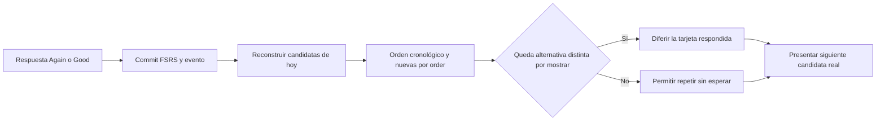

# Mazos: cola diaria dinámica de Aprender

Ampliación posterior: [Ajustes y persistencia local de mixed](DECK_SETTINGS_IMPROVEMENTS.md)
conserva la fórmula de mezcla y elimina el reinicio de fase al recargar cuando el checkpoint coincide.

Entrega local 06/11/2026 sobre `7cba37d67ec1b935ff7a1eb389d391a0fa6b89c2`.
Se conserva la investigación local de Vocabulario, cuya política NO se aplica a Mazos.
Sin commit, push, despliegue, migraciones ni acceso a datos reales.

## Arquitectura y cambio de política

`AnkiStudyPage` → `DeckStudyService.snapshot/chooseNext` → `DeckPersistenceRouter`.
Al revelar se llama a `DeckSchedulerService.preview`; al responder, a `rate` y al
commit transaccional existente. Después se lee de nuevo el estado persistido para
construir la siguiente selección. El historial, Por Tiempo y el resumen siguen
leyendo las mismas tarjetas y eventos efectivos.

Antes: Learning vencidas por instante, Review por recuperabilidad, adelanto Learning
de hasta 20 minutos al agotar otras tareas. Ahora: todos los estados programados
Learning/Review/Relearning se admiten por fecha completa de Europe/Madrid y se
ordenan por due. La hora ordena, no obliga a esperar. No hay un refuerzo paralelo.

Los campos de contadores Learning/Review se conservan para las pantallas existentes;
no son dos colas con prioridades distintas. `learningPending/learningAhead` quedan
en cero, `advanceEntries` vacío. `nextRefreshAt` es la siguiente medianoche Madrid,
sin programar despertares para alcanzar una hora de hoy. El antiguo argumento
allowAhead del helper se admite por compatibilidad de llamadas, sin umbral de 20m.

## Construcción, nuevas y orden

- Solo entra progreso del mazo y de IDs presentes en su índice activo. Se excluyen
  eliminadas/deshabilitadas y tarjetas de otros mazos, sin borrar sus registros.
- Una tarjeta programada entra si su fecha Madrid es hoy o anterior, incluidas
  horas posteriores y las 23:59:59.999. Mañana y fechas posteriores quedan fuera.
- Las programadas se ordenan por timestamp completo, con segundos y milisegundos;
  desempata el ID mediante comparación estable, sin depender del locale del host.
- Las nuevas sin progreso se seleccionan por `order` ascendente y
  después ID. Los IDs duplicados del índice no generan dos introducciones.
- El cupo sigue siendo `newLimitOverride ?? newCardsPerDay` menos IDs introducidos
  únicos de ese día. No limita repasos: 40 repasos + 10 nuevas = 50 unidades iniciales.
- Se conservan before-reviews, after-reviews y mixed. Estas preferencias intercalan
  nuevas con el flujo cronológico de todas las programadas, sin una prioridad
  especial de Learning. Dentro de nuevas nunca hay barajado.
- Una nueva valorada deja de ser candidata nueva y utiliza inmediatamente su FSRS.
  Reducir el cupo no elimina tarjetas introducidas. Un cierre histórico conserva
  cerradas las introducciones, pero no oculta progreso pendiente legítimo recibido
  por sincronización; se conserva el mecanismo existente de ampliar el límite.

Cada snapshot utiliza la fecha de estudio actual: al cruzar medianoche se incorporan
las fechas que pasan a ser hoy. Los límites usan calendario Madrid, incluidos días
de 23/25 horas y cambios de mes/año. Por Tiempo conserva sus grupos «vencidas» y
«hoy más tarde»: ambos pertenecen ahora a Aprender, con fechas guardadas intactas.

## Separación por identidad y restricciones simultáneas

`deck-daily-queue.ts` reconstruye metadatos de presentación a partir de eventos
efectivos del mismo mazo, workspace y día. Para cada respuesta crea una restricción
con el ID de tarjeta y un conjunto de IDs distintos vistos después. Dos IDs distintos
satisfacen la restricción; repetir el mismo ID no cuenta dos veces. Una respuesta
posterior a la misma tarjeta comienza una nueva restricción.

La selección examina candidatos cronológicos/con incorporación de nuevas. Una
restricción bloquea su tarjeta únicamente si todavía queda algún candidato distinto
que no haya contado para ella. El primer candidato no bloqueado gana. Así:

```text
A Otra vez, queda hoy, B/C/D disponibles → B → C → A (si su due es el primero)
A Bien, queda hoy, B/C disponibles       → B → C → A
A queda hoy, solamente B disponible     → B → A
A queda hoy, ninguna alternativa        → A inmediatamente
A pasa a mañana                         → sale; no fuerza una repetición
```



Las otras tarjetas cuentan aunque su respuesta las envíe a mañana. Si permanecen
hoy, reciben sus propias restricciones. Si todas las candidatas estuvieran bloqueadas
por un conjunto de restricciones incompatible tras cambiar el conjunto disponible,
gana la respuesta restringida más antigua, con orden determinista. Ejemplo defensivo:
A/B/C todas restringidas sin apariciones posteriores, orden de restricciones B/C/A:
sale B, no hay un bucle de intentos de selección. No se modifica ningún due.

La presentación intermedia cuenta al confirmar su respuesta. Salir antes de responder
no crea un evento de aparición: al reanudar se reconstruye conservadoramente desde
lo que realmente se guardó. No se añaden eventos ficticios ni campos al protocolo.

## Persistencia, reanudación y precisión histórica

Cada pulsación válida Again/Good sigue calculando una transición real desde el último
snapshot de la tarjeta, con un nuevo evento y su cardBefore. No hay límite artificial
de apariciones ni reutilización de una respuesta anterior. Se mantienen motor
ts-fsrs 5.4.2/FSRS-6, pesos, retención configurable, fuzz, pasos 1m/10m, reaprendizaje
10m y graduación/recuperación a mañana Madrid. El scheduler no se ha modificado.

La cola visual no se guarda como copia de tarjetas. Salir/recargar conserva los
commits y reconstruye candidatas/restricciones leyendo el repositorio. No se llama a
rate por recargar ni por ordenar. Deshacer usa la transacción existente, restaura
cardBefore y elimina/voida el evento; sus restricciones desaparecen al releer.
Los reintentos custom siguen usando recibos idempotentes y revisión de estado obsoleto.

Para respuestas nuevas con el mismo milisegundo se conserva en memoria el orden real
de recibos confirmados, separado por workspace/mazo/día. Consultar otro mazo no lo
borra. No se alteran timestamps. Tras recrear el servicio, si dos tarjetas distintas
tienen exactamente el mismo timestamp, los eventos históricos no contienen un ordinal
global que permita acreditar su orden real. La reconstrucción desempata por reps
previos e ID, igual que la política histórica determinista; no inventa mayor precisión.
Es una limitación explícita del historial existente, sin migración ni cambio de payload.

La lección termina cuando no quedan programadas de hoy/anteriores ni nuevas dentro
del cupo. No termina por una vuelta, número de respuestas, hora futura de hoy o por
repetir demasiado. Un usuario que responde Again indefinidamente puede continuar
indefinidamente y salir cuando quiera; eso no es un bloqueo de selección.

## Ejemplo obligatorio con el motor real

06/11/2026, 12:46 Madrid. Fixtures sin fuzz para resultados repetibles:

| Tarjeta | Due Madrid inicial | Respuesta y resultado real |
| --- | --- | --- |
| 声 | 12:30 | Review + Good → fecha futura; sale |
| 持つ | 12:45 | Review + Good → fecha futura; sale |
| 部屋 | 18:00 | Review + Again → Relearning +10m; queda hoy |
| 食べる | 20:30 | Es la única alternativa; Good → fecha futura; sale |
| 部屋 | El +10m guardado, sin esperarlo | Relearning + Good → mañana Madrid; sale |

Secuencia comprobada: 声 → 持つ → 部屋 → 食べる → 部屋 → fin.
En el ejemplo conceptual del encargo, el intervalo era un minuto: eso corresponde
a Again sobre New/Learning. Para Review, el motor existente utiliza diez minutos;
no se cambia para hacer coincidir artificialmente el ejemplo.
También se prueban New Again +1m y New Good +10m, ambas con dos alternativas antes
de repetir, y siete Again seguidos sin alternativas, con siete eventos reales.

El resumen del ejemplo contiene 4 únicas, 5 valoraciones, 80 % Good y una palabra
para reforzar. El historial de 部屋 contiene Again/Good, y la previsión utiliza los
due finales guardados. El ranking de dificultades sigue contabilizando Again del día,
no inventa fallos por repetir o cambiar de posición.

## Archivos de esta entrega

- `core/services/deck-daily-queue.ts`: reconstrucción y separación pura.
- `core/services/deck-study.service.ts`, `deck-study-time.ts` y
  `core/models/deck-study.model.ts`: selección diaria, cronología, recibos y contadores.
- `features/anki-study/anki-study.page.ts/html`: elimina la marca de adelanto temporal
  antiguo y explica que las tarjetas de hoy pueden aparecer antes de su hora.
- ES/EN/CA y `deck-study.generated.ts`: explicación accesible en el dominio lazy.
- `deck-dynamic-daily-queue.spec.ts` y `manual-tests/deck-learning/dynamic-daily-queue.spec.ts`:
  regresiones nuevas con motor/repositorio/UI reales.
- `deck-study.service.spec.ts`, `deck-scheduler-policy.spec.ts`,
  `custom-deck.repository.spec.ts` y `srs-audit.spec.ts`: sustituyen expectativas de la
  antigua prioridad/espera por la nueva política, conservando cobertura.
- `scripts/audit-kaishi-media.mjs`: la congelación del servicio completo de selección
  ya no aplica al cambio autorizado. Conserva protegidos el scheduler FSRS, datos,
  gates, SQL y workflows; añade protección explícita del motor de Vocabulario.
- `scripts/audit-manga-candidate.mjs`: verifica el aviso de restricción de cuenta
  entrando por el enlace de almacenamiento a Ajustes. Su antigua expectativa de
  un aviso grande en portada había quedado obsoleta con la entrega de historial.
  Se mantiene la aserción exacta del aviso, las rutas bloqueadas y los datos intactos.
- Este documento y enlaces desde arquitectura SRS y la guía Por Tiempo.

Japanese 1500 conserva contenido/IDs; Puyi sigue usando catálogo público y progreso
privado; custom sigue usando su repositorio, CAS, recibos y journal, sin activar cloud.
Workspace A/B y Guest no comparten progreso ni restricciones. No se modifica SQL,
FSRS, Vocabulario, Stats V2, gates, backups ni contratos de sincronización.

## Validación y limitaciones

Validaciones ejecutadas sobre el estado final:

- Nuevos tests Angular: 19/19, con motor y persistencia reales; incluye secuencia
  obligatoria, 0/1/2 alternativas, respuestas simultáneas, siete Again,
  restricciones simultáneas, recarga/undo, cupo, 40 repasos, segundos/milisegundos,
  empate estable, exclusiones y límites Madrid de día/mes/año/ambos DST.
- Dirigidos finales: 125/125 en siete archivos (cola dinámica, servicio, política
  scheduler, repositorio custom, Puyi, página Aprender y auditoría SRS).
- Suite completa Angular: 2350/2350, 229 archivos. La ejecución previa, antes de añadir
  los dos últimos casos, pasó 2349/2349. No hubo exclusiones, sleeps ni reintentos automáticos.
- TypeScript app/spec: ambos correctos (`npx tsc -p tsconfig.app.json --noEmit` y spec).
- Builds normal y candidato: correctos bajo `/kana-study/`, cuatro warnings SCSS de
  Gramática ya conocidos. Iniciales 747.078 / 747.964 bytes, ambos <750.000.
- Playwright: 33/33 en Edge, escritorio oscuro, móvil claro y 320px oscuro; incluye
  nueve casos nuevos, historial/resumen/Por Tiempo y Puyi. Primera ejecución: los
  nueve nuevos fallaron al preparar el fixture antes de inicializarse IndexedDB;
  se corrigió esperando al estado visible de Angular, sin sleeps. Repetición dirigida
  3/3 y ejecución final completa 33/33. Sin cambios productivos para resolver ese fallo.
- Auditoría Manga candidato: 3/3 ES/EN/CA, con importación UI, diccionario, FSRS/undo,
  backup/restauración exacta, reinicio, A→B→A, dos pestañas, Auth SDK con HTTP controlado,
  cero RPC/REST custom y cero tráfico externo. Usa un adaptador ignorado en `.cache`
  para seleccionar Edge porque Chromium empaquetado no está instalado; no modifica
  el script de producción ni valida Auth remoto. La expectativa obsoleta del aviso
  descrita arriba falló primero y pasó tras trasladar su comprobación a Ajustes.
- Auditoría SRS: 67 transiciones y ecuaciones pasan con ts-fsrs 5.4.2/FSRS-6.0.
- Auditorías de Kaishi/grafos, Gramática, i18n y enlaces: correctas. ES/EN/CA y el
  generado lazy coinciden. Los guards confirman motores, contenido Japanese 1500,
  gates, workflows y SQL sin cambios. Whitespace de archivos nuevos y `git diff --check`: correctos.

Capturas: `.cache/deck-daily-queue/study-{desktop-dark,mobile-light,narrow-dark}.png`,
`completed-{desktop-dark,mobile-light,narrow-dark}.png`
y `history-{desktop-dark,mobile-light,narrow-dark}.png`. Se inspeccionó visualmente
el resumen de 320px y Aprender en móvil claro; se conservan estilos semánticos, foco y solo dos ratings.
Logs/capturas locales ignorados por Git en `.cache/deck-daily-queue/`.
No se validan Supabase Auth/RLS real ni Safari/dispositivos físicos en esta entrega.
Los ejecutables Firefox/WebKit no están instalados: la auditoría registra su
indisponibilidad, sin presentarla como validación. Sigue siendo imposible recuperar
un orden global histórico exacto de tarjetas distintas con el mismo milisegundo tras
reiniciar; se usa el desempate documentado. No hay bloqueos pendientes de las pruebas locales requeridas.
